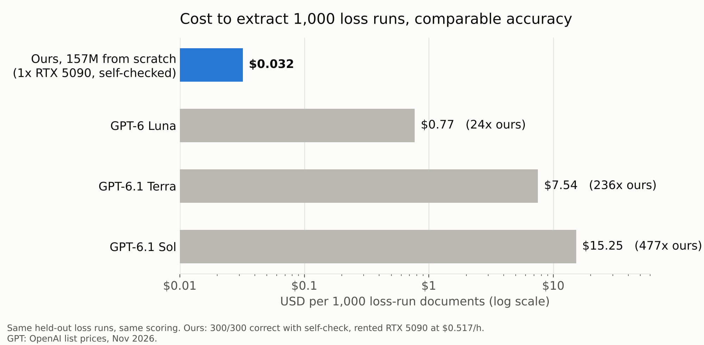
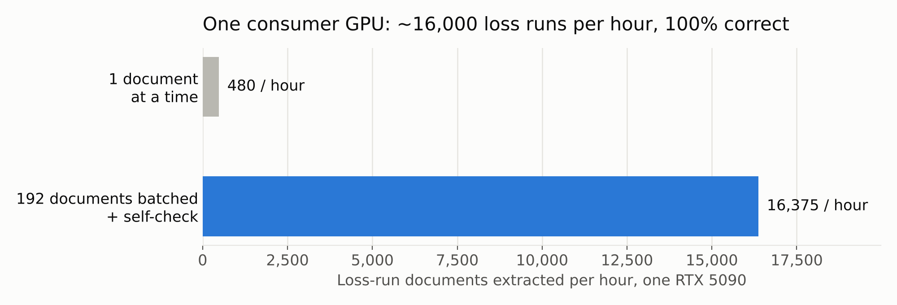

# Hybrid SSM loss-run extractor (157M, trained from scratch)

A small language model with our own **Mamba-2 / Transformer hybrid architecture** (14 state-space layers + 2 attention layers),
pre-trained from scratch and specialised to one job: turning US commercial-insurance **loss runs** into clean structured data.

**Result in one line:** on 300 held-out loss runs, **300/300 extracted perfectly with 0 silent errors**, at
**$0.032 per 1,000 documents** on one consumer GPU: about **24x cheaper than the cheapest GPT model and 235-475x cheaper
than GPT-6.1 Terra / Sol**. It can run on the customer's own hardware, so claims data never leaves their network.

## Results

Held-out test set: 300 synthetic loss runs generated with a different random seed than training (never seen by the model),
5 layouts (tables, fixed-width, blocks, CSV, narrative), several date and money formats, page breaks, "no losses" policies.
Every model is scored by the same script (`score.py`).

| | **Ours v2** (157M, from scratch) | GPT-6 Luna | GPT-6.1 Terra | GPT-6.1 Sol |
|---|---|---|---|---|
| Perfect documents | **300/300** with self-check (298/300 raw) | – | 50/50 (case-insensitive) | – |
| Claim field accuracy | 100% | 100% | 100% | 100% |
| Claim recall / precision | 100% / 100% | 100% / 100% | 100% / 100% | 100% / 100% |
| USD per 1,000 documents | **$0.032** | $0.77 | $7.54 | $15.25 |

GPT: OpenAI list prices (Nov 2026), one-shot prompt, 300 docs (Luna, Terra) / 100 docs (Sol). GPT models copy carrier names
exactly as printed (often in capitals); the case-insensitive score counts that as correct.

**Self-check (`validate.py`).** Every extraction is checked against rules all loss runs obey (incurred = paid + reserve,
dates inside the policy period, Closed claims have no open reserve) and against the source text (every amount and claim number
must literally appear in the document). A document that fails is re-decoded with 4 sampled alternatives, batched, and the
first one that passes is kept; anything still failing goes to a human. On the test set: 2 documents flagged, 2 fixed,
0 false alarms on correct documents, **0 silent errors**.

**Throughput:** one RTX 5090 ($0.517/h rented) processes ~16,400 loss runs per hour including the self-check
(192 documents per batch, grouped by length, bf16). On the customer's own GPU the marginal cost is roughly $0.01 per 1,000.

**Arithmetic (v2):** 100% on a 300-question basic test (+/- up to 99, times tables, exact division); 56% on a harder mix
with 4-digit numbers and dollar sums (up from 12% before the arithmetic fine-tune).

## Architecture

| | |
|---|---|
| Parameters | 156.7M |
| Layers | 16: Mamba-2 (SSD) x14, attention x2 (layers 6 and 12), RMSNorm, SwiGLU, RoPE, tied embeddings |
| Width | d_model 768, state 64, head dim 64 |
| Pre-training | 3B tokens (FineWeb-Edu + synthetic arithmetic + loss runs), 2x A100 40GB, ~10 h |
| Fine-tuning | 40k loss runs + arithmetic, then 2 refinement rounds (400k arithmetic, 42k new loss runs incl. long amounts) |
| Inference | constant-size SSM state + small KV cache for 2 layers: memory grows very slowly with document length |

Earlier controlled experiment (same data, same size, 38M): the hybrid reached 7% lower perplexity than a pure Transformer,
processed 32K-token documents 1.8x faster and needs ~9x less memory to serve.

## Limitations and next steps
* Test documents are synthetic. Real carrier loss runs are messier, so we are now collecting real samples from agencies through free pilots.
* Scanned PDFs need OCR first (standard tooling).
  
## What is in this repository
* `results/summary.json` - every number above
* `examples/` - sample loss runs from the test set with the expected output
* `score.py` - the scoring script used for every model
* `validate.py` - the self-check rules (usable on any extraction, including GPT output)
* `gpt_baseline.py` - how the GPT models were run and scored
* `charts/` - figures

Model weights, architecture code and training pipeline are private; access for diligence on request.

Contact: Arda Göktaş · goktasarda453@gmail.com · [LinkedIn](https://www.linkedin.com/in/ardagoktas-ai/) · Free pilot on your own loss runs: just email me.
